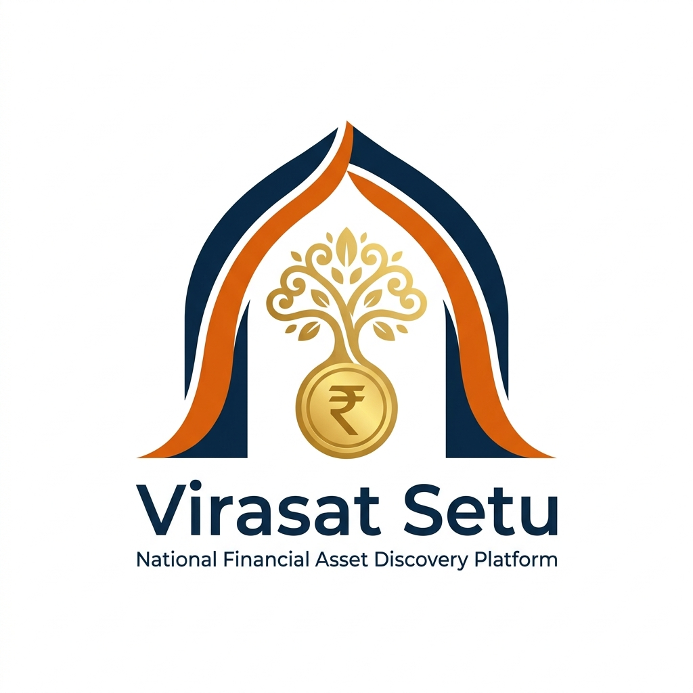
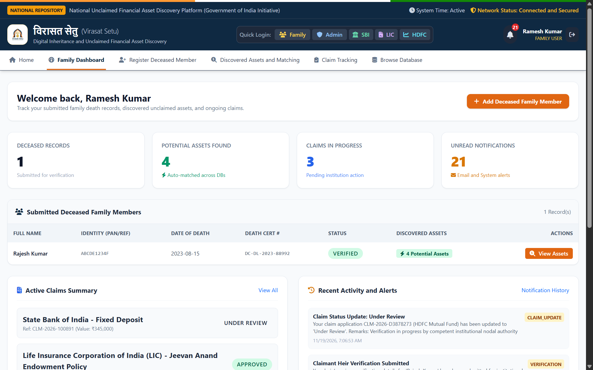
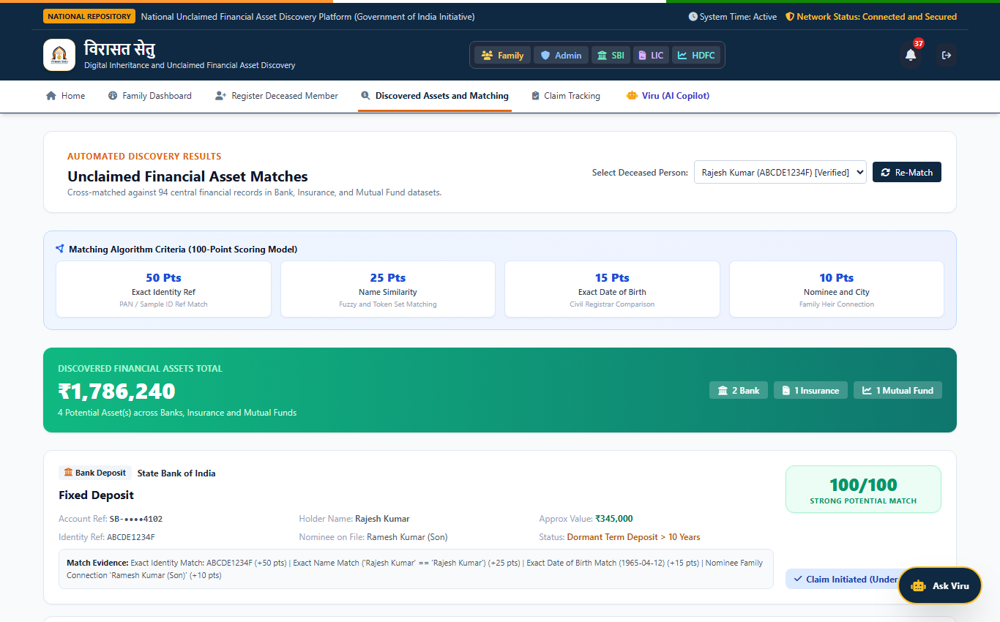
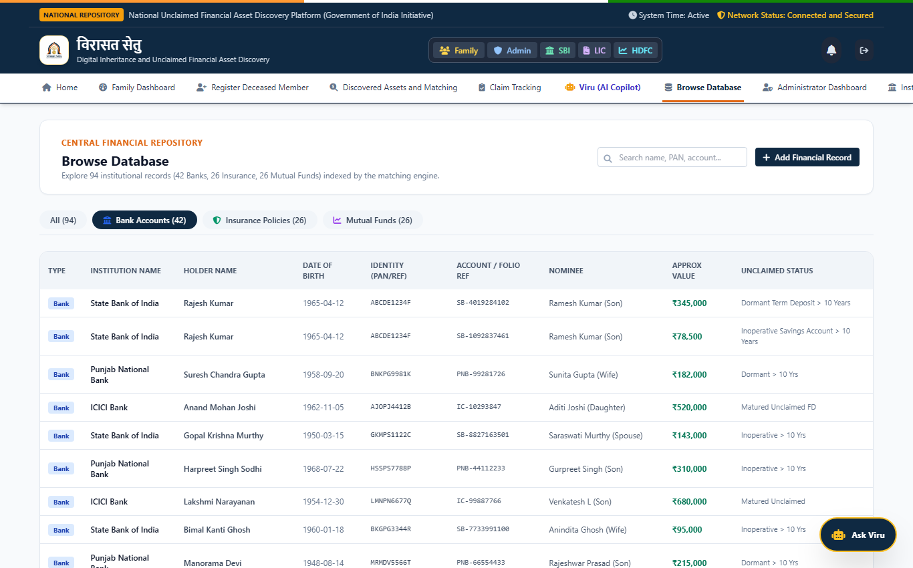
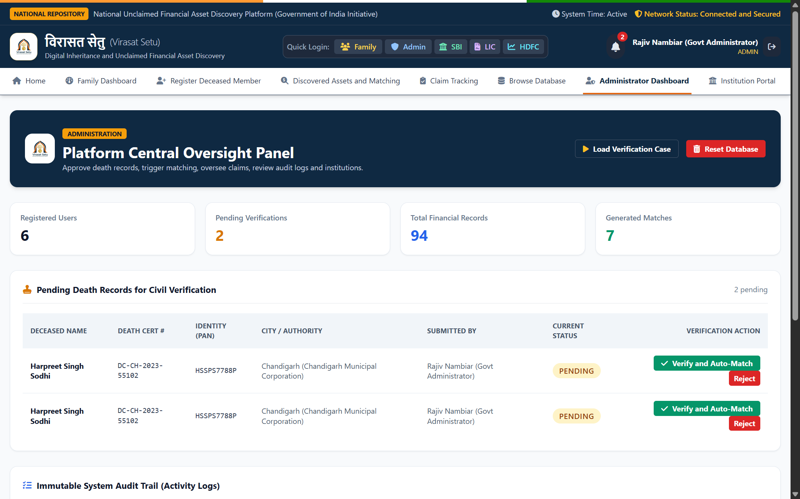

# Virasat Setu Digital Inheritance Platform:

DTI Project: Group 14.

Live Public Portal: https://virasat-setu-eight.vercel.app

Caption: Virasat Setu official visual identity emblem featuring the sovereign arch, Kalpavriksha seedling and national wealth nodes.

## Project Overview:

Virasat Setu is an enterprise digital inheritance and asset discovery portal created to solve the challenge of unclaimed wealth across India. Every year substantial savings, term deposits, matured insurance policies and mutual fund folios remain dormant because legal heirs and designated nominees remain unaware of their existence. Virasat Setu bridges citizen families with institutional repositories through automated identity matching, civil registration verification and transparent claim tracking.

Virasat Setu Platform Flow:
1. Citizen Portal: Register Deceased Records and Track Claim Progress.
2. Government Oversight: Verify Civil Certificates and Execute Matching Engine.
3. Central Matching Engine: One Hundred Point Identity and Record Verification.
4. Banking Desk: State Bank of India, Punjab National Bank and Bank of Baroda.
5. Insurance and Funds Desk: Life Insurance Corporation, HDFC Mutual Fund and SBI Funds Management.

## Platform Visual Interface Gallery:

Caption: Virasat Setu citizen portal landing page and four stage discovery workflow overview.

Caption: Automated asset discovery interface displaying verified holdings and one hundred point match scores.

Caption: Central repository database browser searching across ninety four institutional financial records.

Caption: Administrative oversight console managing civil record verifications, platform metrics and claim workflows.

## Executive Summary and Scope:

Financial dormancy in India exceeds one point five lakh crore rupees. This wealth sits idle across public sector banks, private banking institutions, life insurance companies and asset management companies. Family members facing bereavement often lack records of policies or deposits held by their deceased relatives. Virasat Setu establishes a unified discovery pipeline where submitted death certificate references are cross verified against institutional databases without exposing sensitive banking credentials.

## Core Capabilities and Functional Modules:

1. Citizen and Family Registration: Allows family members to create authenticated profiles and submit deceased person records with Google OAuth 2.0 single sign on.
2. Civil Certificate Registration: Captures official municipal death certificate numbers, dates of registration and issuing authorities, supporting submission with or without certificate upload.
3. Automated Discovery Engine: Evaluates identity parameters against banking, insurance and fund records using a weighted one hundred point scoring algorithm enhanced by machine learning Indian name transliteration.
4. Virasat AI Legal Copilot: Dual engine legal intelligence assistant combining Google Gemini 3.8 Flash generative AI with an embedded offline Indian Succession Legal Knowledge Engine.
5. Citizen Claim Health Predictor: Five dimension readiness evaluator providing real time approval probability scoring (25% to 98%) and prescriptive documentation checklists.
6. Administrative AI Fraud and Anomaly Intelligence Center: Role gated security engine detecting duplicate claim conflicts, high value dormancy and relationship discrepancies.
7. Browse Database Interface: Provides transparent search capabilities across ninety four institutional financial records strictly restricted to platform administrators.
8. Claimant Verification Workflow: Supports legal heir and nominee submissions with civil documentation proofs.
9. Institutional Claim Desk: Equips authorized representatives from banks and insurers with verification consoles to review claims and issue formal updates.
10. Event Notification Pipeline: Dispatches instant in portal alerts and logs simulated official email communications.
11. Multi Tier Cybersecurity Defenses: Implements defense in depth against SQL injection, cross site scripting, cross site request forgery, path traversal and credential brute forcing.
12. Complete Administrative Audit Trail: Records every status transition, matching execution and verification action in immutable system logs.

## Technology Stack Summary:

1. Backend Framework: Python FastAPI server executing asynchronous high throughput REST endpoints.
2. Database Layer: SQLAlchemy Object Relational Mapping with Supabase PostgreSQL cloud hosting and local SQLite support.
3. Presentation Interface: Single Page Application built with modern HTML5, Tailwind styling and native JavaScript.
4. Cloud Deployment: Configured for unified serverless deployment on Vercel with PostgREST data synchronization.
5. Security Model: JSON Web Token session protection with fine grained role authorization and password encryption.

## One Hundred Point Weighted Discovery Algorithm:

The matching engine searches across institutional records without human bias. It computes a transparent composite score based on the following weighted criteria:

1. Exact Identity Reference Match: Fifty points awarded when the sample identity reference like Permanent Account Number matches exactly.
2. Full Name Token Similarity: Up to twenty five points awarded based on character sequences, phonetic similarity and token order.
3. Exact Date of Birth Match: Fifteen points awarded when birth dates match completely, or eight points if birth years match.
4. Family Nominee and Branch City Connection: Ten points awarded when the declared nominee matches claimant surnames or branch cities align.

Potential records with scores from eighty to one hundred points are categorized as Strong Potential Matches. Records with scores from sixty to seventy nine points are marked as Requires Manual Review. Records below sixty points are excluded from candidate generation.

## Quick Start Verification Guide:

To launch and explore the platform locally:

1. Ensure Python version three point ten or higher is installed on your computer.
2. Install all necessary dependencies by executing pip install with requirements text.
3. Run the application server using python run server py or executing run server bat.
4. Navigate to http 127 0 0 1 8000 in your web browser or access the live deployment directly at https://virasat-setu-eight.vercel.app.
5. Select the Admin portal or quick login to view an instant complete verification scenario.
6. Inspect the four discovered assets totaling seventeen lakh eighty six thousand two hundred and forty rupees across State Bank of India, Life Insurance Corporation of India and HDFC Mutual Fund.
7. Switch roles using the top navigation header to test administrator verification and institutional claim approvals.

## Live Production Deployment:

The complete platform is hosted live on Vercel with serverless Python and Supabase cloud data storage:

1. Public Web Portal URL: https://virasat-setu-eight.vercel.app.
2. System Health Verification: https://virasat-setu-eight.vercel.app/api/health.
3. Central Financial Institutions Endpoint: https://virasat-setu-eight.vercel.app/api/institutions.

## Documentation Index:

Detailed operational and technical manuals are organized in the documentation folder:

1. documentation/Usage md: Comprehensive user guide explaining citizen, administrator, institution, AI copilot and fraud center workflows.
2. documentation/AIMLIntegrations md: Artificial intelligence, machine learning transliteration, AI Legal Copilot, claim predictor and fraud intelligence specifications.
3. documentation/WebCyberSecurity md: Web cybersecurity architecture, OWASP defenses, SQL injection, XSS, CSRF mitigations, rate limiting and HTTP security headers.
4. documentation/Visuals md: Visual architecture, screen inventory, interface component gallery, color palette and design specifications.
5. documentation/CodeBaseIndex md: Complete file directory map, structural charts and module descriptions.
6. documentation/Architecture md: Detailed architectural specification, data flow diagrams and scoring algorithms.
7. documentation/InstallationAndSetup md: Step by step local setup, automated testing and cloud deployment procedures.
8. documentation/Tech md: In depth technical specifications, database schema definitions and API endpoint references.
9. documentation/DTI md: Complete Digital Transformation and Innovation specification and Business Model Canvas.
10. documentation/LogoDesign md: Official brand identity, color palette and geometric construction rules.
11. documentation/DTIProjectPlan md: Project planning specifications and phase by phase milestones.
