# Virasat Setu Visual Architecture and Interface Design Specification:

This document establishes the comprehensive visual inventory, interface layout design, chromatic system and user experience architecture across the Virasat Setu platform.

Virasat Setu Visual Asset Directory:
1. Official Sovereign Brand Emblem: [logo.jpg](../Visuals/logo.jpg).
2. Citizen Portal Home Interface: [portal_home.png](../Visuals/portal_home.png).
3. Authenticated Citizen Family Dashboard: [citizen_dashboard.png](../Visuals/citizen_dashboard.png).
4. Deceased Person Registration Form: [register_deceased.png](../Visuals/register_deceased.png).
5. Discovered Assets and Matching Console: [discovered_matches.png](../Visuals/discovered_matches.png).
6. Citizen AI Claim Health and Readiness Meter: [claim_health.png](../Visuals/claim_health.png).
7. Claim Progress Tracking Console: [claim_tracking.png](../Visuals/claim_tracking.png).
8. Central Financial Database Browser: [browse_database.png](../Visuals/browse_database.png).
9. Central Administrative Oversight Console: [admin_console.png](../Visuals/admin_console.png).
10. Administrative AI Fraud and Anomaly Center: [fraud_anomaly.png](../Visuals/fraud_anomaly.png).
11. Institutional Claim Processing Desk: [institution_desk.png](../Visuals/institution_desk.png).
12. Viru (Virasat AI Legal Copilot) Interface: [viru_copilot.png](../Visuals/viru_copilot.png).
13. Google Identity OAuth Two Point Zero Authentication: [google_oauth.png](../Visuals/google_oauth.png).
14. System Notifications Center Modal: [notifications_modal.png](../Visuals/notifications_modal.png).
15. Project Coursework Reference Visual: [GroupNumber_14.jpeg](../Visuals/GroupNumber_14.jpeg).
16. Master Figma UI and UX Design Board: [VirasatSetu_Figma_Master_UIUX.svg](../Visuals/VirasatSetu_Figma_Master_UIUX.svg).

## Interface Design Philosophy:

Virasat Setu provides a sovereign digital public interface engineered to balance institutional gravitas with accessible clarity for citizens during times of family bereavement:

1. Sovereign National Identity: The interface prominently features the official Indian tricolor accent bar along the top header, anchoring the portal within authorized digital public infrastructure.
2. Cognitive Load Reduction: Clear step by step progressive disclosures guide users through complex civil registration and claim initiation workflows without overwhelming legal jargon.
3. Accessible High Contrast Hierarchy: Deep navy typography set against clean white and cool slate backgrounds provides optimal readability across desktop monitors, tablets and mobile screens.
4. Role Contextual Adaptation: The interface dynamically reshapes navigation tabs, action buttons and metric cards based on the authenticated role (citizen family user, institutional desk officer or platform administrator).

## Visual Chromatic System:

The platform palette synthesizes national identity with financial dignity:

1. Sovereign Navy (Hex 0F2942): Dominates the navigation bar, primary brand accents, modal headers and authoritative typography. It communicates security, data protection and constitutional legitimacy.
2. Radiant Saffron (Hex E06612): Used for primary action buttons, key metrics, status highlights and the top tricolor accent band. It signifies civic warmth, energetic service and helpful guidance.
3. Growth Emerald (Hex 138808): Used for successful matching badges, approved claim indicators, active system state and the lower tricolor band. It denotes financial renewal and legal resolution.
4. Heritage Gold (Hex D4AF37): Highlights asset valuations, prominent financial totals and the Kalpavriksha sprout in the brand emblem. It visually represents recovered family wealth.
5. Slate Field (Hex F8FAFC): Provides an eye friendly background that softens display contrast and reduces visual fatigue during extended browsing.
6. Border Subtle (Hex E2E8F0): Defines modular card boundaries, table cell separators and form input perimeters with clean geometric precision.

## Primary Visual Screen Inventory:

### 1. Citizen Portal Landing Screen:

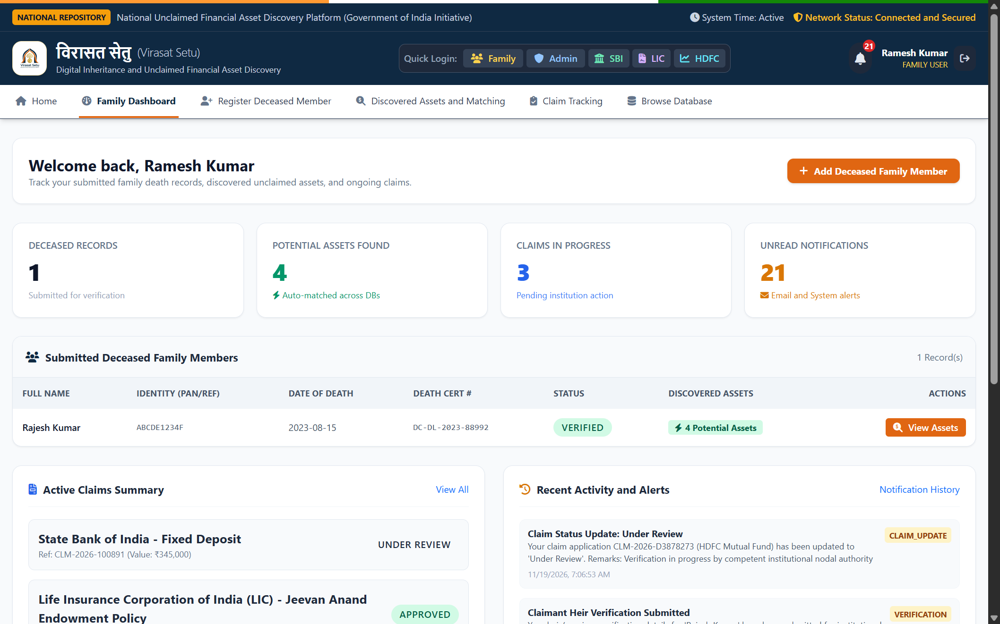

Caption: Virasat Setu citizen portal landing page displaying sovereign header, impact metrics counter, four stage discovery workflow and quick action triggers.

1. Sovereign Portal Header: Features the official Virasat Setu bilingual wordmark and emblem, primary navigation links, quick role switcher and authentication triggers.
2. Impact Metric Counter: Prominently displays central statistics including forty two bank accounts, twenty six insurance policies, twenty six mutual funds and total indexed national wealth exceeding one crore rupees.
3. Four Step Discovery Stepper: Visually maps the citizen journey from civil registration through administrative verification, automated asset discovery and institutional claim settlement.
4. Quick Action Banners: Direct buttons allowing immediate registration of deceased family members, rapid role switching for evaluation and exploration of the central financial database.

### 2. Authenticated Citizen Family Dashboard:

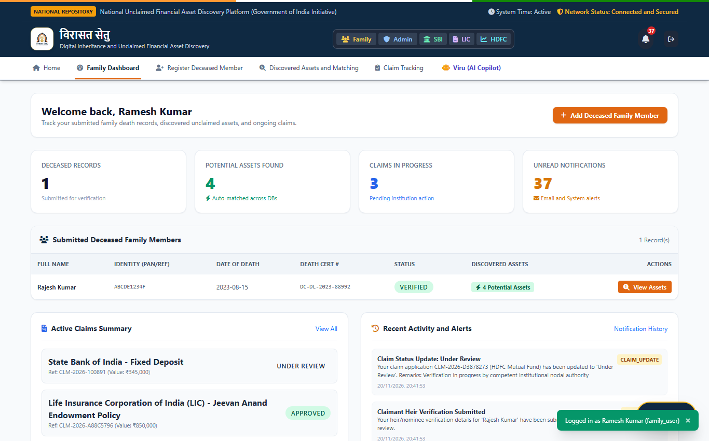

Caption: Family dashboard displaying personal metric summaries, submitted deceased family records, in progress claim steppers and recent system events.

1. Family Metric Cards: Summarizes total registered deceased relatives, candidate asset matches discovered, claims currently under review and unread notification alerts.
2. Submitted Deceased Table: Lists registered family members with municipal certificate references, verification state and discovery action shortcuts.
3. Active Claims Summary: Provides quick status badges showing ongoing claim verifications across banking and insurance desks.
4. Recent Activity Stream: Displays chronological system updates including match discoveries, certificate validations and nodal officer remarks.

### 3. Deceased Person Registration Form:

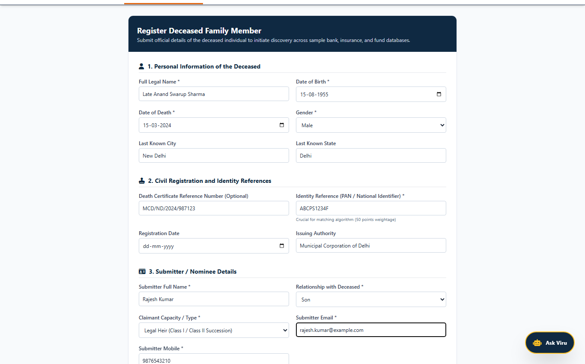

Caption: Four section civil death registration interface collecting personal vitals, municipal certificate references and claimant relationship declarations.

1. Section One Personal Information: Captures deceased full legal name, gender, date of birth, date of death and last known residential city and state.
2. Section Two Civil Registration: Records municipal death certificate reference numbers, issuing municipal corporation authorities and national identity identifiers like PAN.
3. Section Three Document Attachment: Enables optional civil death certificate document uploads with instant client side file validation.
4. Section Four Claimant Profile: Collects claimant full name, mobile number, email address, family relationship and legal entitlement category.

### 4. Discovered Assets and Matching Console:

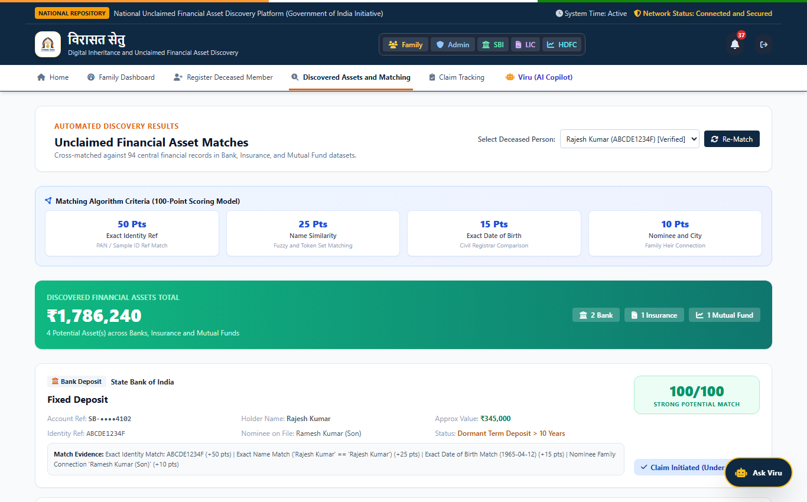

Caption: Automated asset discovery interface displaying verified holdings, institution titles, masked account folios and one hundred point match scores.

1. Deceased Selection Bar: Dropdown selector allowing citizens to toggle between multiple registered deceased family members.
2. Matching Confidence Cards: Each identified financial asset is displayed in a dedicated card displaying asset category (Bank, Life Insurance, Mutual Fund), institution name, masked account number, holder name and estimated valuation.
3. Visual Score Pill: A color coded circular badge indicating the exact matching score between zero and one hundred points, categorized as Strong Potential Match or Requires Manual Review.
4. Transparent Score Breakdown: Clickable score analysis showing attributed points across identity reference, token name distance, birth date alignment and branch location.
5. Initiate Claim Trigger: A prominent button launching the formal claim preparation modal.

### 5. Citizen AI Claim Health and Readiness Meter:

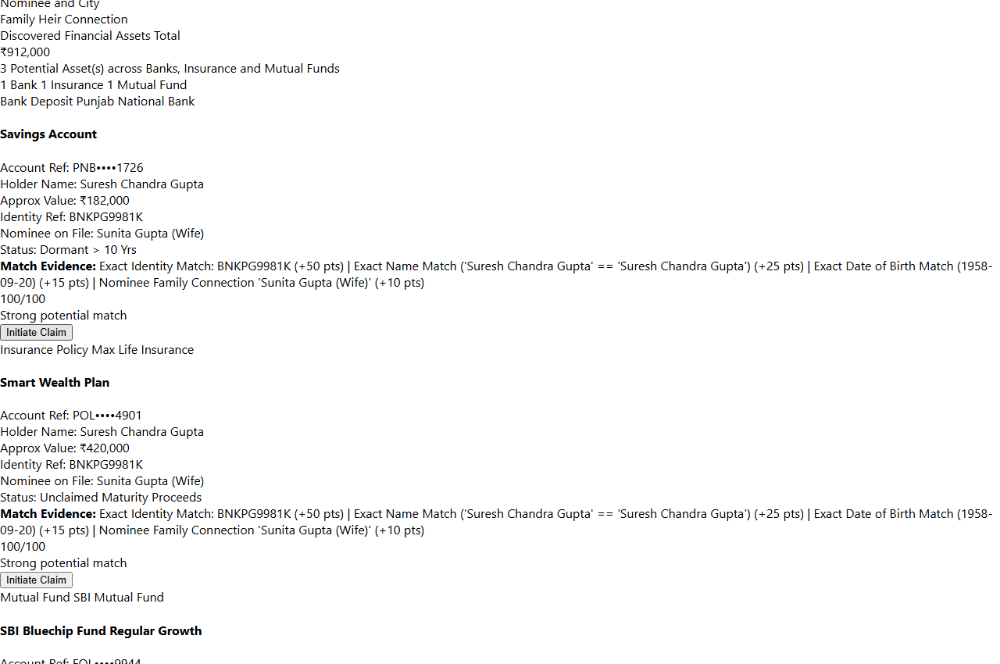

Caption: Claim preparation dialog featuring the embedded five dimension AI Claim Health Predictor gauge, approval probability percentage and documentation checklist.

1. Embedded Modal Placement: Positioned directly within the formal claim preparation modal above the claimant details form.
2. Circular Readiness Gauge: A visual percentage score ring color coded from amber (low readiness) to emerald (high readiness) indicating calculated approval odds between twenty five and ninety eight percent.
3. Dynamic Status Badge: Labels claims as High Approval Likelihood, Moderate Approval Likelihood, or Enhanced Diligence Required.
4. Prescriptive Action Cards: Bulleted recommendation boxes detailing exact affidavits, indemnity bonds, no objection certificates, or succession certificates needed to maximize approval odds prior to submission.
5. Officer Remarks Input: Textarea enabling claimants to submit supplemental contextual declarations or legal heir certificate references.

### 6. Claim Progress Tracking Console:

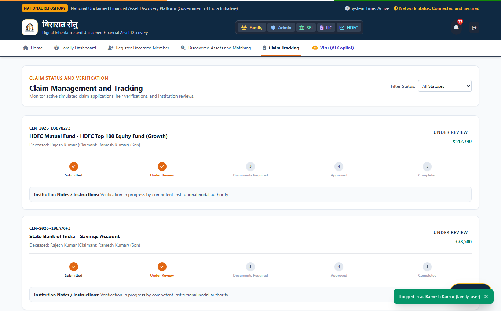

Caption: Multi stage claim tracking interface illustrating the five step lifecycle stepper, active institutional status and official officer remarks.

1. Five Stage Visual Stepper: Maps the complete claim lifecycle across Initiated, Civil Verified, Institution Review, Document Verification, and Settled stages.
2. Institution Details Banner: Displays institution insignia, branch location, asset category, account folio and claimed valuation.
3. Status Indicator Badges: Color coded pills denoting current operational stage and review status.
4. Official Officer Remarks: Chronological audit notes dispatched by institutional desk officers guiding families through document submissions or settlement updates.

### 7. Central Financial Database Browser:

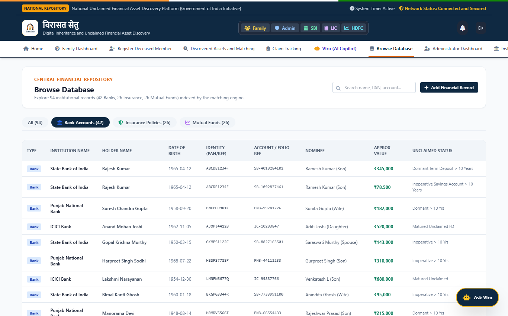

Caption: Central repository database browser searching across ninety four institutional financial records, gated strictly to administrators.

1. Strict Administrative Gating: Hidden from standard citizens and accessible exclusively to authenticated platform administrators and institutional officers.
2. Multi Institution Directory: Categorized directory of forty two bank deposits, twenty six life insurance policies and twenty six mutual fund folios.
3. Category Filtering Pills: Instant filter buttons allowing officers to isolate records by institutional type: All Assets, Bank Accounts, Insurance Policies, and Mutual Funds.
4. Real Time Search Input: Instantaneous filter field searching across holder names, account references and municipal identity codes.
5. Tabular Asset Metrics: Formatted columns showing institution title, product category, holder legal name, birth date, dormancy tenure, approximate valuation and current asset status.

### 8. Central Administrative Oversight Console:

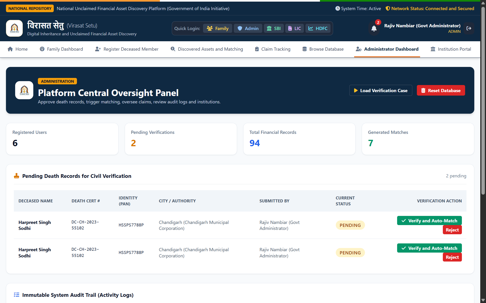

Caption: Administrative command center presenting platform vital statistics, civil certificate review queue, single click verification actions and audit logs.

1. Platform Vital Statistics: Metric cards summarizing total registered citizen users, verified civil records, active candidate matches, and pending claims.
2. Civil Death Certificate Review Queue: Actionable table listing submitted deceased records with citizen contact information, certificate references, and issuing municipal authorities.
3. Single Click Verify and Match Action: Green verification button that validates civil records and triggers the automated one hundred point matching engine across all central databases.
4. System User Provisioning Panel: Complete interface allowing administrators to create new administrators, institutional officers or citizen accounts with instant directory updates.
5. Immutable Audit Log Viewer: Chronological table recording user logins, verification determinations, matching engine runs and claim determinations with client IP addresses and timestamps.

### 9. Administrative AI Fraud and Anomaly Center:

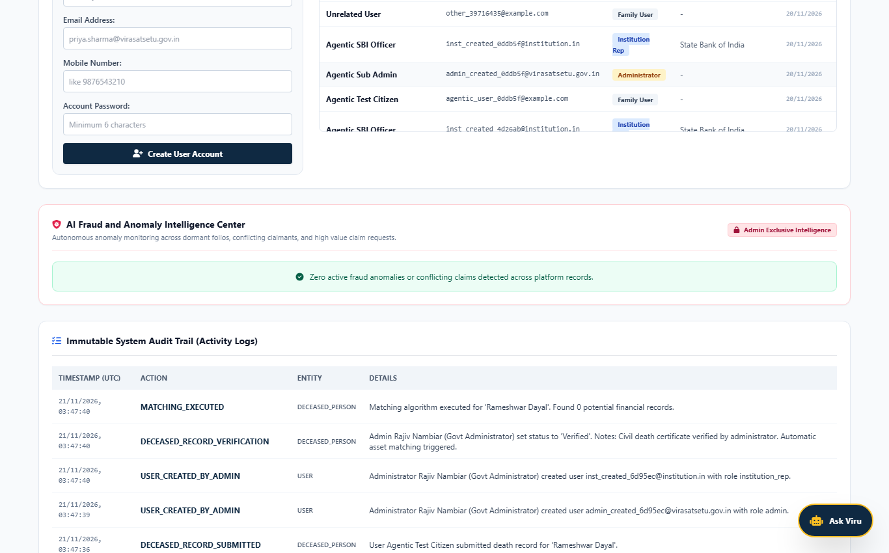

Caption: Central administrative fraud detection console displaying real time duplicate claim warnings, high value dormancy alerts and relationship discrepancy cards.

1. Segregated Administrative Placement: Positioned exclusively within the Administrator Dashboard and Financial Institution Desks.
2. High Priority Anomaly Cards: Styled with high visibility crimson and amber alert borders highlighting potential risks:
   * Duplicate Claim Conflicts: Flags multiple distinct citizens filing claims on the same underlying financial folio.
   * High Value Dormancy Warnings: Highlights dormant assets exceeding five lakh rupees requiring mandatory dual officer scrutiny.
   * Nominee Hierarchy Discrepancies: Identifies claims where declared claimant relationship conflicts with recorded institutional records.
3. Direct Action Buttons: Enables officers to place conflicting claims on administrative hold, request court succession certificates, or clear verified claims.

### 10. Institutional Claim Processing Desk:

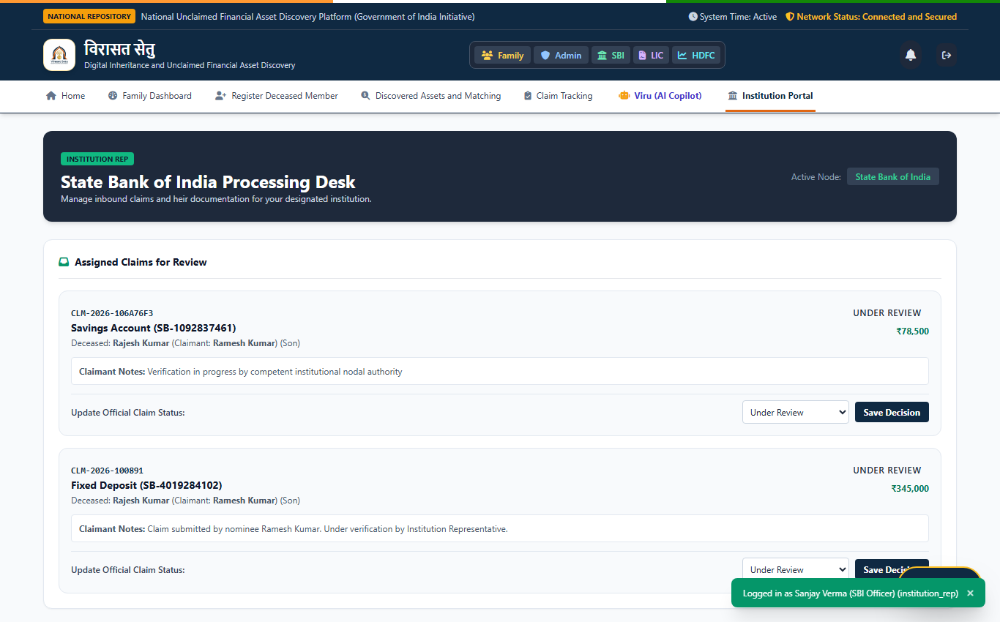

Caption: Dedicated verification desk for banking and insurance officers, featuring pending claim queues, document reviews and decision buttons.

1. Institutional Header and Branding: Displays designated financial institution identity like State Bank of India, Life Insurance Corporation or HDFC Mutual Fund.
2. Institutional Metric Counters: Tracks total claims assigned to the institution, pending reviews, approved payouts and documentation requests.
3. Assigned Claims Queue: Tabular overview of submitted citizen claims containing claimant contact info, deceased legal references and claimed values.
4. Tripartite Decision Controls: Action buttons empowering officers to approve verified claims, request supplemental civil documentation or reject conflicting submissions.

### 11. Viru: Virasat AI Legal Copilot Interface:

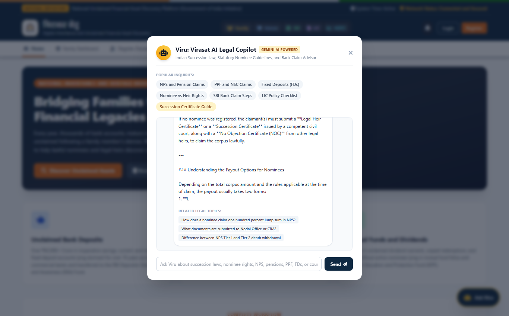

Caption: Viru conversational legal intelligence interface rendering real time statutory guidance, prompt chips and step by step legal checklists.

1. Floating Action Launcher: An unobtrusive, modern circular floating button anchored at the bottom right of the screen featuring an artificial intelligence spark emblem and labeled Ask Viru.
2. Dedicated Navigation Tab: An accessible top navigation tab titled Viru (AI Copilot) providing direct modal access.
3. Interactive Knowledge Dialog: A sleek modal window titled Viru: Virasat AI Legal Copilot presenting conversational legal intelligence regarding the Hindu Succession Act, Indian Succession Act, Supreme Court nominee rulings and institutional procedures.
4. Quick Inquiry Chips: Four clickable pre formulated prompt pills allowing instant one click exploration of common succession questions:
   * Class 1 Legal Heirs under Hindu Succession Act.
   * Difference between nominee rights and legal heir rights.
   * SBI deceased bank account claim documents.
   * LIC death claim documentation requirements.
5. Formatted Markdown Rendering: Responses are structured with bold statute references, bulleted documentation checklists and step by step guidance.

### 12. Google Identity OAuth Two Point Zero Authentication Dialog:

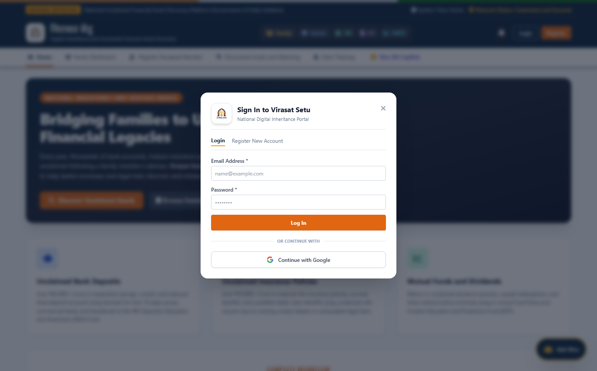

Caption: Authentication modal featuring the official Continue with Google identity button alongside traditional email credentials.

1. Prominent Modal Placement: Embedded at the top of the authentication dialog above the traditional credential inputs.
2. Standard Google Identity Styling: White button with official Google multicolored emblem, clean typography reading Continue with Google, and smooth hover elevation.
3. Traditional Sign In Alternatives: Clean email and password inputs with password visibility toggle and evaluator demonstration switcher buttons.
4. Seamless User Feedback: Displays subtle loading feedback during token validation and transitions smoothly into the authenticated citizen portal upon completion.

### 13. System Notifications and Alerts Center Modal:

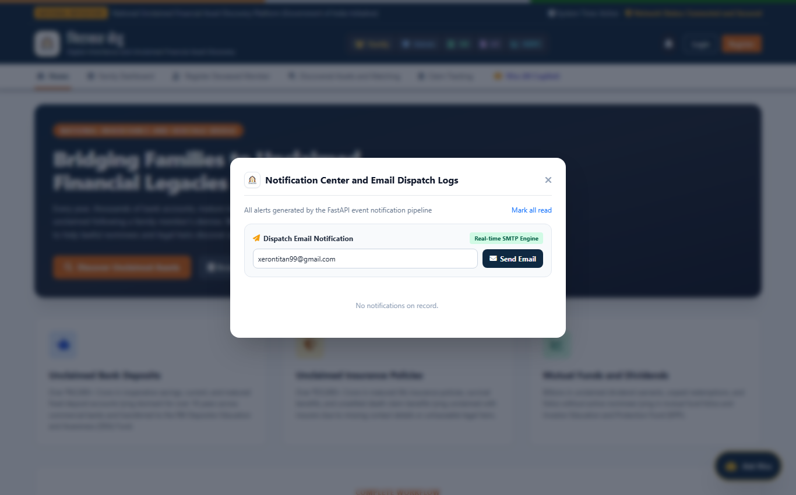

Caption: Notifications center modal displaying real time system alerts, asset discovery notices, simulated email headers and read state controls.

1. Unread Notification Counter: Bell icon in the sovereign header displaying a real time badge counting unread alerts.
2. Categorized Notification Cards: Lists recent events including new asset discoveries, civil certificate approvals, and institutional claim transitions.
3. Simulated Email Dispatch Inspector: Displays complete email subject lines, timestamps, sender routing and official body text simulating government communications.
4. Global Read State Trigger: Single click Mark all read button clearing pending alerts across the portal.

### 14. Master Figma UI and UX Design Board (VirasatSetu_Figma_Master_UIUX.svg):

1. Single File Design Import: Self contained vector artboard combining all fifteen screens in a three column layout with titles, subtitles, national tricolor banner, and full high resolution visual interface captures.
2. Zero Setup Figma Opening: Dragging this SVG file into an empty Figma canvas instantly lays out the entire platform architecture for presentation and client reviews with zero manual arrangement needed.
